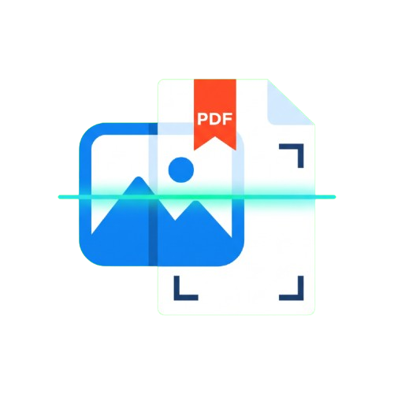

<p align="center">
  
</p>

<h1 align="center">Image to PDF Scanner</h1>

<p align="center">
  Turn the images in posts, chats and web pages into a clean, <b>page-by-page PDF</b> — in one click, fully offline.
</p>

A browser extension for **Microsoft Edge** and Google Chrome (and other Chromium browsers). Capture **every image of a multi-image post** (LinkedIn, Facebook / Messenger, WhatsApp Web, Telegram Web, or any web page) instead of saving them one by one to your phone, then clean each page up like a document scanner would — auto-crop, perspective fix, straightening, shadow removal, HD upscaling — and export a PDF, optionally with searchable text (OCR).

**Everything runs locally in your browser.** No account, no server, no tracking, no network calls. Your images never leave your computer.

> Not affiliated with, endorsed by, or sponsored by LinkedIn, Meta (Facebook, Messenger), WhatsApp, Telegram or Microsoft. Those names are used only to describe which websites the extension can read images from. All trademarks belong to their owners.

---

## Table of contents

1. [Features](#features)
2. [Installation](#installation)
3. [Quick start](#quick-start)
4. [Capturing images](#capturing-images)
5. [Site-by-site guide](#site-by-site-guide)
6. [The editor](#the-editor)
7. [Exporting](#exporting)
8. [Settings](#settings)
9. [Privacy, permissions and security](#privacy-permissions-and-security)
10. [Troubleshooting](#troubleshooting)
11. [How it works](#how-it-works)
12. [Project structure](#project-structure)
13. [Development](#development)
14. [Known limitations](#known-limitations)
15. [Third-party software](#third-party-software)
16. [Author](#author)

---

## Features

**Capture**
- 🖱 **Hover buttons** on any image: **＋ PDF** (add this image) and **📄 Whole post** (capture all images of the post / album).
- 📌 **Whole-post capture** for multi-image posts (e.g. a LinkedIn post showing 4 images and "+16"), Messenger albums, WhatsApp media and Telegram albums.
- ▭ **Drag-select**: draw a box around several images on any page.
- 🖼 **Add all large images on the page**.
- Right-click menu, toolbar popup and keyboard shortcuts.
- A persistent **basket** that survives across posts, sites and browser restarts — collect from several places and export one PDF.
- Automatic **de-duplication** (by image ID and by what the picture looks like) and automatic removal of icons, avatars and ad banners.
- Add **local images** too: file picker, drag & drop, or paste.

**Scan-quality cleanup (per page or all pages)**
- Auto **crop + perspective correction** for photographed pages.
- **Manual crop** with four draggable corners.
- **Deskew** (straighten tilted text), **rotate**, **shadow / uneven-light removal**.
- Looks: **Original · Enhanced colour · Magic colour · Scan B&W · Grayscale**, plus brightness and contrast.
- **HD upscale** for low-resolution images (denoise → enlarge → deblur), on by default.
- **Blank-page finder**.

**Export**
- **PDF** with page size (A4 / Letter / Legal / fit-to-image), orientation, margins and three file-size presets.
- **OCR** → searchable, selectable text inside the PDF — **English, Bangla, Hindi, Arabic, Spanish, French, German**, all built in and working offline.
- Watermark, page numbers, **password protection**.
- **ZIP of PNG or JPG** images, and a **plain-text** export of the recognised text.
- **Export history** (last 12 PDFs, re-downloadable).
- Automatic file name from the post author and date.
- Light / dark theme.

---

## Installation

### Microsoft Edge
1. Open `edge://extensions`.
2. Turn on **Developer mode** (left sidebar).
3. Click **Load unpacked** and select this project folder (the one containing `manifest.json`).
4. Pin the extension from the puzzle-piece menu so the icon is always visible.
5. **Reload any tab that was already open** (LinkedIn, WhatsApp, …) so the extension can attach to it.

### Google Chrome / Brave / other Chromium browsers
Same steps at `chrome://extensions` (or `brave://extensions`).

After changing any file, click **reload ↻** on the extension's card, then refresh the website tab.

---

## Quick start

1. Open a post with several images (for example on LinkedIn).
2. **Hover** over one of its images. Two buttons appear in the image's top-right corner.
3. Click **📄 Whole post**. The extension opens the photo viewer, walks through every image and adds them to the basket. A message in the bottom-right shows progress.
4. Click the toolbar icon → **Open basket & editor**.
5. Check the pages, adjust if you want (crop, look, order), then click **⬇ Download PDF**.

---

## Capturing images

### The hover buttons
Hover any image that is at least ~150 px large:

| Button | What it does |
|---|---|
| **＋ PDF** | Adds just this image to the basket. |
| **📄 Whole post** | Captures all images of the post/album the image belongs to. |

### The toolbar popup
| Item | What it does |
|---|---|
| 📌 Capture whole post (all images) | Same as **Whole post** for the image you last hovered (or the image nearest the middle of the screen). |
| ▭ Drag-select images on page | Dims the page; drag a box — every image at least 30 % inside it is added, in reading order. `Esc` cancels. |
| 🖼 Add all large images on page | Adds every image ≥ 200 px on the page. Handy on gallery pages; it can also pick up ads, so review the basket. |
| 🗂 Open basket & editor | Opens the editor in a new tab. The badge shows how many images are in the basket. |

### Right-click menu
- **Add image to PDF basket** (on an image)
- **Capture all images of this post → PDF basket**
- **Drag-select images on this page**
- **Open PDF basket / editor**

### Keyboard shortcuts
| Shortcut | Action |
|---|---|
| `Alt+Shift+C` | Capture whole post (image under the mouse) |
| `Alt+Shift+S` | Drag-select mode |
| `Alt+Shift+E` | Open the editor / basket |

Change them at `edge://extensions/shortcuts` (or `chrome://extensions/shortcuts`).

### Other ways to add images
In the editor: **＋ Add images** (file picker), **drag & drop** files onto the window, or **paste** (`Ctrl+V`) an image from the clipboard.

### What is filtered automatically
- Images smaller than about **240 px** on the longest side or **80 px** on the shortest (icons, tracking pixels, ad banners).
- **Duplicates**: the same photo is recognised even when a site serves it under different URLs (size variants, one-off `blob:` links). Only near-identical pictures are dropped — two different pages that share a layout are both kept.

---

## Site-by-site guide

> Websites change their markup often, so capture on a given site can occasionally stop working until the extension is updated.

### LinkedIn
- Open the **post itself** (click its date/text) or use the home feed, hover the image grid and click **📄 Whole post**.
- The extension opens the first image, steps through the viewer with **Next**, and stops at the expected number (it reads the "+N" badge) or when it sees an image twice.
- LinkedIn ignores simulated clicks on its image grid. If the viewer doesn't open, turn on **Compatibility mode** in [Settings](#settings).
- A **row of separate posts** (e.g. your profile's Activity section) is not one post — open the post first.
- Feed images are low resolution; the extension asks for the larger variant first and falls back to the original.

### Facebook, Messenger and Facebook chat
- Open a photo from the album/message, hover it and click **📄 Whole post**.
- If the viewer has a filmstrip ("View photo 1 … N"), all full-size photos are read straight from it — no clicking. Otherwise the extension steps with **Next**.
- Messenger may also need **Compatibility mode** if the viewer won't open.

### WhatsApp Web
- Hover the photo you want to start from and click **📄 Whole post**.
- A prompt asks **how many photos** to capture, starting from that one (default 10). Leave it empty to capture to the end of the chat's media.
- Photos are taken at full size from the media viewer, not from the chat thumbnails.

### Telegram Web
- **Albums**: an album is one message; all of its photos are read **directly from the message** — no viewer, so it can't wander into other messages. Photos that haven't loaded yet are scrolled into view and waited for (up to 10 s).
- **Single photo**: uses the viewer, with a "how many photos" prompt (default 1).

### Instagram, X (Twitter), Pinterest and any other site
- **＋ PDF**, drag-select and "add all large images" work everywhere.
- X and Pinterest image links are upgraded to original size automatically.
- **Whole post** works on sites whose full-screen viewer has a labelled **Next** button or responds to the right-arrow key.

---

## The editor

Open it from the toolbar popup or with `Alt+Shift+E`.

```
┌────────────┬──────────────────────────────┬─────────────────────┐
│ Thumbnails │  Preview of the current page │  Enhancement + PDF  │
│ (reorder,  │  (rotate, crop, compare,     │  options + export   │
│  tick,     │   copy image, delete)        │  buttons            │
│  delete)   │                              │                     │
└────────────┴──────────────────────────────┴─────────────────────┘
```

### Top bar
| Button | What it does |
|---|---|
| ＋ Add images | Add local image files. |
| Select all / Select none | Tick or untick every page (ticked pages are the ones exported). |
| Delete selected | Remove ticked pages. |
| Clear basket | Remove everything. |
| Find blank pages | Ticks pages that look empty so you can delete them. |
| ✨ Auto-enhance all | Reset every page to the default automatic settings. |
| 🕘 History | Re-download earlier PDFs (last 12). |
| ⚙ Settings | Theme, Compatibility mode, Developer mode. |

### Thumbnail list
- Click a page to open it. **Drag** thumbnails to reorder (the order is saved).
- The checkbox marks pages for export or deletion; **✕** removes a page.
- Thumbnails show the *processed* result, so crops and filters are visible immediately.

### Stage toolbar
`◀ ▶` previous / next page · `⟲ ⟳` rotate · **✂ Crop / perspective** · **Reset page** · **👁 Hold: original** (press and hold to compare with the untouched image) · **⧉ Copy image** (copies the page as a PNG) · **🗑 Delete page**.

Keyboard: `↑ ↓ ← →` change page · `Delete` removes the current page.

### Page enhancement panel
Choose **This page** or **All pages** at the top; every change applies to that scope.

**Look**
| Look | Best for |
|---|---|
| **Original** | No colour processing. |
| **Enhanced colour** *(default)* | Gentle denoise, automatic levels (grey paper becomes white, ink stays dark), mild sharpen. |
| **Magic colour (shadow-free)** | Documents with uneven lighting or shadows — keeps colour. |
| **Scan B&W (documents)** | High-contrast black-and-white, like a scanner. |
| **Grayscale** | Plain grey. |

**Options**
| Option | What it does |
|---|---|
| **Auto crop edges & fix perspective** *(default on)* | Detects a photographed page (tilted / in perspective) and flattens it; otherwise trims solid dark or coloured borders. It **never trims plain white margins**, so slide and diagram designs stay intact. |
| **Straighten tilted text (deskew)** | Corrects tilt up to ±10°. |
| **Remove shadows / even out light** | Evens out lighting (already built into *Magic* and *Scan*). |
| **HD upscale for low-resolution** *(default on)* | Edge-preserving denoise → enlarge to about 2400 px → deblur with a strength matched to the enlargement. Skipped for images that are already large. |
| **Brightness / Contrast** | Manual fine-tuning. |

> **About HD upscale.** It restores edge contrast and removes noise, which makes text and diagrams visibly clearer. It cannot invent detail that was never in the image — extremely small text may stay unreadable. It is classic image processing, **not** an AI model.

### Manual crop
Click **✂ Crop / perspective**, drag the four corner handles to match the page edges, then **Apply crop**. **Auto-detect** returns to automatic detection; **Full image** removes cropping.

---

## Exporting

Exports the **ticked pages**, or **all pages if none are ticked**.

### PDF options
| Option | Choices |
|---|---|
| **File name** | Filled automatically from the post author and date (e.g. `Rahul-Yadav-2026-11-19`). Edit freely. |
| **Page size** | A4 · Letter · Legal · Fit to image |
| **Orientation** | Auto (landscape for wide images) · Portrait · Landscape |
| **Margin** | None · Small (14 pt) · Medium (28 pt) · Large (48 pt) |
| **File size** | **High quality** (up to 3200 px, JPEG 92 %) · **Balanced** (2400 px, JPEG 85 %) · **Small** (1500 px, JPEG 60 %, for WhatsApp / e-mail) |
| **Make text searchable (OCR)** | Adds an invisible text layer so you can search and copy text. |
| **OCR language** | English · Bangla · English + Bangla · Hindi · Arabic · Spanish · French · German |
| **Page numbers** | "1 / N" at the bottom of each page. |
| **Watermark** | Diagonal text with adjustable opacity (5–60 %). |
| **Password** | Optional; the PDF asks for it to open (printing and copying stay allowed). |

Pages using the **Scan B&W** look are stored losslessly (PNG) unless you choose the *Small* preset.

### Export buttons
| Button | Result |
|---|---|
| **⬇ Download PDF** | The finished PDF (also saved to History). |
| **ZIP · PNG / ZIP · JPG** | Every page as a numbered image (`page-001.png`, …) in one ZIP. |
| **📝 Export text (OCR .txt)** | Recognised text of all pages in one text file. |

A progress window shows each step and has a **Cancel** button.

### OCR notes
- The OCR engine and all seven languages are **bundled** — nothing is downloaded, and it works offline.
- Bangla text is embedded with the Noto Sans Bengali font. The layer is searchable, but copied Bangla text can come out with letters in a different order, because conjunct shaping isn't applied to hidden text.

---

## Settings

Open **⚙ Settings** in the editor.

| Setting | What it does |
|---|---|
| **Theme** | Match system · Light · Dark. |
| **Compatibility mode (LinkedIn, Messenger)** | Off by default. Some sites ignore simulated clicks, so **Whole post** cannot open their photo viewer. This mode sends real mouse and keyboard input through the browser's debugging interface. It asks for one extra permission (`debugger`); the browser shows a *"debugging this browser"* bar only while a capture is running. Turn it off again at any time to remove the permission. |
| **Developer mode** | Adds an "Inspect page" report to the popup and saves a log file when a capture comes up short. Only needed when working on the code. |

---

## Privacy, permissions and security

- **All processing is local**: cropping, enhancement, OCR and PDF creation run inside your browser. There is no server, no account and no analytics.
- **No network use of its own**: the extension only downloads the image files you ask it to capture, from the page you are on. OCR data and all libraries are bundled.
- **Storage**: the basket and history live in your browser's IndexedDB; preferences in `chrome.storage`. **Clear basket** and the history ✕ delete them.
- See **[PRIVACY.md](PRIVACY.md)** for the full privacy policy.

| Permission | Why it is needed |
|---|---|
| Site access (`<all_urls>`) | Show the hover buttons on the pages you browse and download the image files you choose to capture. |
| `scripting` | Attach the capture helper to tabs that were already open when the extension was installed or updated. |
| `storage` | Remember your settings (theme, options). |
| `contextMenus` | The right-click entries. |
| `debugger` *(optional, off by default)* | Only if you turn on **Compatibility mode**: send real mouse/keyboard input to sites that ignore simulated clicks. Attached only during a capture, then detached. |

---

## Troubleshooting

| Problem | What to try |
|---|---|
| Nothing happens / no hover buttons | Reload the extension and **refresh the website tab**. Hover buttons only appear on images ≥ 150 px. |
| **Whole post** captured fewer images than the post has | The photo viewer may not have opened. Open the first photo yourself and click **Whole post** again. On LinkedIn / Messenger, turn on **Compatibility mode** in Settings. |
| "This image is in a row of separate posts" (LinkedIn) | Open the post itself first (click its date), then capture. |
| Images are blurry or tiny | Feed and chat thumbnails are low-res. Use **Whole post** (it opens the full-size viewer) and keep **HD upscale** on. |
| Telegram album: "Added 7 of 10" | Remaining photos hadn't loaded. Scroll that album into view for a moment and capture again; duplicates are skipped automatically. |
| A page was cropped too tightly / not at all | Use **✂ Crop / perspective**, or untick **Auto crop** for that page. |
| Text looks too sharp / too soft | Switch **Look** (Original → Enhanced → Magic), or untick **HD upscale** for that page. |
| PDF too large to share | Choose **File size → Small**. |
| Editor shows "Could not load image engine" | Reload the extension. |
| A "debugging this browser" bar appears | Expected only while **Compatibility mode** is on and a capture is running; it disappears when the capture ends. |
| Duplicate images in the basket | Tick them and **Delete selected**. |

---

## How it works

```
 Web page  ──►  content.js ──────────►  background.js (service worker)
 (hover bar,     │  finds images,         │  fetches image bytes (bypasses page CORS),
  drag-select,   │  drives viewers,       │  drops icons / duplicates,
  viewer         │  reads albums          │  stores them in IndexedDB (the "basket"),
  stepping)      │                        │  real-input fallback (optional permission)
                 ▼                        ▼
            on-page message       IndexedDB  ◄──────  editor.html / editor.js
                                                       │ thumbnails, preview, panel
                                                       ├─► process.js ──postMessage──► cvsandbox.html (sandbox-cv.js)
                                                       │                                OpenCV.js: crop, perspective,
                                                       │                                deskew, shadows, filters, HD upscale
                                                       └─► export.js: jsPDF (PDF), Tesseract.js (OCR), JSZip (ZIP)
```

- **Manifest V3**, no build step, plain JavaScript.
- **OpenCV runs in a sandboxed page.** OpenCV.js needs `unsafe-eval`, which extension pages may not use, so it lives in `cvsandbox.html` (a manifest `sandbox` page) and exchanges pixel data with the editor through `postMessage`. The sandbox has no access to extension APIs.
- **Viewer capture** is layered: generic "full-screen overlay containing a big image" detection → simulated mouse/keyboard events → real input (only with Compatibility mode) → page data → visible tiles. Every layer stops on a repeated image, an expected count, or a hard limit.
- **Chat sites** use shortcuts when possible: Messenger's filmstrip and Telegram's album message already contain the full-size photos.
- **Crop detection** looks for a tilted/perspective quadrilateral, otherwise a solid dark/coloured margin; axis-aligned boxes and white margins are treated as design and left alone.
- **De-duplication** uses the image ID for CDN URLs and a 48×48 grayscale fingerprint for everything else (flat/blank pictures are never compared).

---

## Project structure

```
manifest.json         Extension manifest (MV3), permissions, shortcuts, CSP
background.js         Service worker: context menu, shortcuts, fetching, basket, optional real-input fallback
content.js            Injected into pages: hover bar, drag-select, viewer capture, album reading
content.css           Styles for the hover bar, message, drag-select overlay
popup.html / .js      Toolbar popup
editor.html / .js     The editor (basket, preview, panel, export)
editor.css            Editor layout / styling
theme.css             Light / dark theme variables
process.js            Editor-side client for the OpenCV sandbox
cvsandbox.html        Sandboxed page hosting OpenCV
sandbox-cv.js         Image pipeline: crop, perspective, deskew, shadows, filters, HD upscale
export.js             PDF building (jsPDF), OCR (Tesseract.js), text layer
db.js                 IndexedDB helper (basket + history)
icons/                Toolbar / store icons (generated from mainlogo.png)
mainlogo.png          Project logo (transparent PNG)
vendor/               Bundled libraries, OCR engine and OCR language data
store/                Edge Add-ons listing text (STORE_LISTING.md) and store graphics (not part of the package)
tools/package.js      Builds the upload ZIP into dist/
PRIVACY.md            Privacy policy
THIRD_PARTY_NOTICES.md  Licences of bundled software
```

---

## Development

- **No build step.** Edit the files, click **reload ↻** on the extension card, refresh the target tab.
- **Syntax check:** `node --check content.js` (and the other `.js` files).
- **Package for the store:** `node tools/package.js` creates `dist/image-to-pdf-scanner-<version>.zip` containing only the files the extension needs.
- **Site-specific capture** lives in `runCaptureInner` in `content.js` (viewer detection, next/close buttons, album readers). Turn on **Developer mode** in Settings to get an "Inspect page" report in the popup and a log file when a capture comes up short.
- **Headless testing:** the editor, OCR and PDF export can be driven with `puppeteer-core` and a local Chrome using the `enableExtensions` launch option (recent Chrome ignores `--load-extension`).
- There is no automated test suite in the repository yet.

---

## Known limitations

- **Site markup changes.** LinkedIn, Facebook, WhatsApp and Telegram can change their pages at any time; capture is built from their current structure and may need updating.
- **Not an AI upscaler.** HD upscale improves clarity but cannot recover detail that isn't there.
- **Bangla copy-paste order** in OCR text can be off (search still works).
- **Videos and GIFs** in posts or albums are skipped; only still images are captured.
- **Signed or expiring image links** may fail to download; the extension then falls back to the original size.
- **Telegram Web K** (the older web version) isn't covered by the direct album reader; only Telegram Web A's album markup has been checked.
- The extension is about 36 MB unpacked (19 MB as a download) because the image engine, OCR engine and seven OCR languages are bundled so it works fully offline.

---

## Third-party software

Everything below is bundled in `vendor/`. See **[THIRD_PARTY_NOTICES.md](THIRD_PARTY_NOTICES.md)** for licence details.

| Library | Used for | License |
|---|---|---|
| [OpenCV.js](https://opencv.org/) | Crop, perspective, deskew, filters, upscaling | Apache-2.0 |
| [jsPDF](https://github.com/parallax/jsPDF) | Building PDFs (text layer, watermark, encryption) | MIT |
| [Tesseract.js](https://github.com/naptha/tesseract.js) + core | OCR engine | Apache-2.0 |
| [tessdata_best](https://github.com/tesseract-ocr/tessdata_best) language data | OCR languages | Apache-2.0 |
| [JSZip](https://stuk.github.io/jszip/) | ZIP export | MIT |
| [Noto Sans Bengali](https://fonts.google.com/noto) | Embedding Bangla OCR text | SIL OFL 1.1 |

---

## Author

**Created and maintained by Tashrif Rashid Sourav**

| | |
|---|---|
| ✉️ Email | [tashrifrashid.sourav@gmail.com](mailto:tashrifrashid.sourav@gmail.com) |
| 💼 LinkedIn | [linkedin.com/in/tashrif-rashid-sourav](https://www.linkedin.com/in/tashrif-rashid-sourav/) |

Found a bug, a site that stopped working, or have an idea for a feature? Send an email.

© 2026 Tashrif Rashid Sourav. All rights reserved unless a `LICENSE` file says otherwise.
